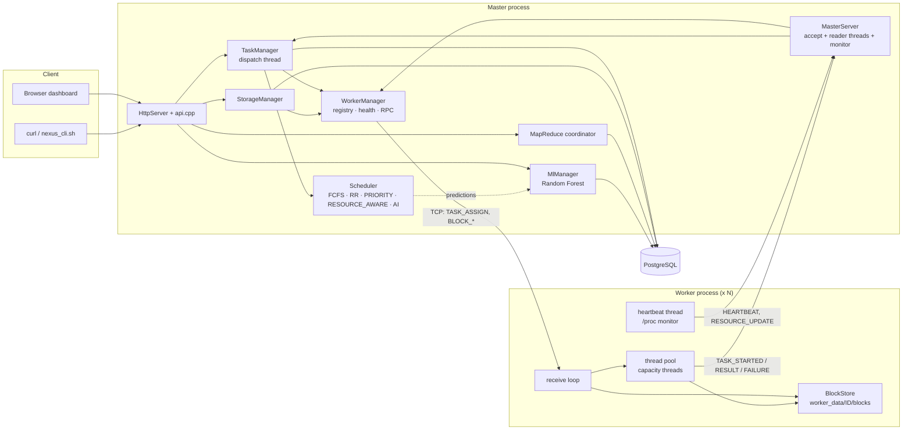
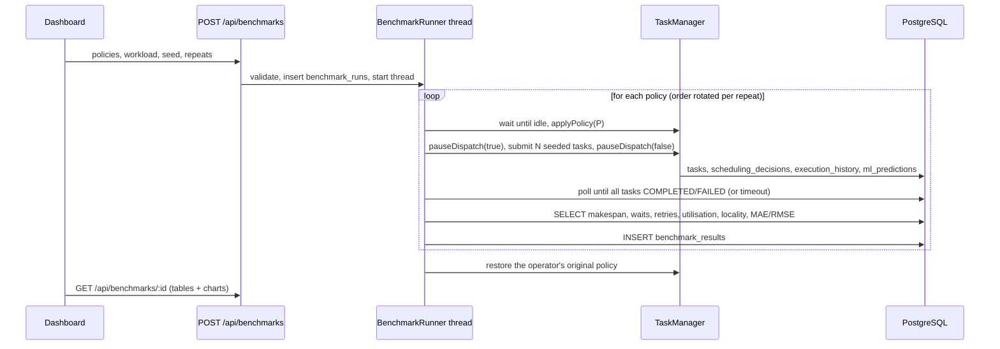
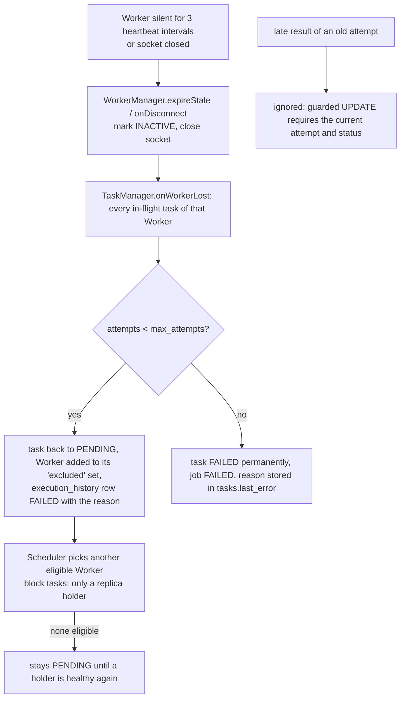

# NEXUS architecture

## 1. Components and threads



| Thread (Master) | Job |
|---|---|
| main | console on stdin, signal handling |
| accept thread | `accept()` on the Worker port |
| one reader thread per Worker | parses that Worker's messages (heartbeat, resources, task results, block replies) |
| monitor thread (every 0.5 s) | expires Workers whose last heartbeat is older than 3 × heartbeat; closes their socket; re-queues their tasks |
| dispatch thread (every 0.3 s or when woken) | one scheduling pass: snapshot Workers, order the queue by policy, pick Workers, claim tasks in PostgreSQL, send `TASK_ASSIGN` |
| HTTP accept thread + one short-lived thread per request | dashboard + API (max 64 concurrent connections) |

| Thread (Worker) | Job |
|---|---|
| main | connect/register, receive loop, answers `BLOCK_*` requests (small, fast disk jobs) |
| `capacity` pool threads | execute tasks – this is where multi-core parallelism happens |
| heartbeat thread | every `NEXUS_HEARTBEAT_SEC`: `HEARTBEAT` then `RESOURCE_UPDATE` (reads `/proc`) |

Shared state is guarded by mutexes (`TaskManager::mutex_` for queue + in-flight map, `WorkerManager::mutex_`, one mutex around the single libpq connection, per-connection send mutex).
Database calls never happen while the task mutex is held.

## 2. Wire protocol (TCP, one line per message)

`TYPE|key=value|key=value\n` – values percent-escaped (`|`, `=`, `%`, newline). Lines are limited to 24 MB; garbage lines are skipped, not fatal.

| Message | Direction | Fields |
|---|---|---|
| `REGISTER_WORKER` | W→M | `worker_id, hostname, cpu_cores, memory_mb, capacity, threads, logical_cpus, cpu_affinity, affinity_status, affinity_detail` – must be the first message; id must be `[A-Za-z0-9_-]{1,32}` |
| `REGISTER_ACK` | M→W | `status=OK` or `status=REJECTED, reason` (duplicate live id) |
| `HEARTBEAT` | W→M | `seq, running` |
| `RESOURCE_UPDATE` | W→M | `cpu, ram, disk, ram_avail_mb, load1, rss_mb, running, capacity, storage_bytes` (out-of-range values are ignored) |
| `TASK_ASSIGN` | M→W | `task_id, attempt, task_label, task_type, scale, params` (url-encoded key/values) |
| `TASK_STARTED` | W→M | `task_id, attempt, start_ms` |
| `TASK_RESULT` | W→M | `task_id, attempt, exec_time, result, data, start_ms, end_ms, concurrent` |
| `TASK_FAILURE` | W→M | `task_id, attempt, error, retryable, exec_time, …` |
| `BLOCK_STORE / FETCH / VERIFY / DELETE` | M→W | `req_id, block_id, [checksum], [data=base64]` |
| `BLOCK_REPLY` | W→M | `req_id, ok, error, [data, checksum, state, size]` |

The `attempt` number travels with every task message, so the Master can recognise and ignore a late result of an attempt it has already given up on.

## 3. Task state machine

```
            submit                 dispatch (guarded UPDATE ... WHERE status='PENDING')
   (none) ─────────► PENDING ──────────────────────────────────► ASSIGNED ──TASK_STARTED──► RUNNING
                        ▲                                            │                          │
                        │   retryable failure / Worker lost /       │                          ├─ TASK_RESULT ─► COMPLETED
                        └─────────── heartbeat expired ─────────────┴──────────────────────────┤
                                                                                                └─ attempts exhausted / non-retryable ─► FAILED
```
Every arrow is a SQL `UPDATE … WHERE status IN (<expected states>)`; the claim of a task and its `scheduling_decisions` / `ml_predictions` rows are **one statement** (CTE), so they commit together or not at all.
Completion = one transaction (task row + `execution_history` + prediction actual + job row).

## 4. Database overview

```
workers 1──* resource_metrics          jobs 1──* tasks 1──* execution_history *──1 workers
workers 1──* block_replicas *──1 blocks *──1 datasets        tasks 1──* scheduling_decisions *──1 workers
jobs 1──* job_stages   jobs 1──* mr_intermediate *──1 tasks   jobs 1──* mr_reduce_outputs   jobs 1──* mr_results
tasks 1──* ml_predictions *──0..1 ml_training_runs            scheduler_config(key,value)    task_types(reference)
```

## 5. Scheduling data flow (one dispatch pass)

1. `WorkerManager::snapshot()` + in-flight counts → `SchedWorker` list (health from heartbeat age, metrics age, CPU/RAM/disk, running, capacity).
2. Pending tasks → `SchedTask` (priority, type, scale, input bytes, replica holders for block tasks, workers to avoid).
3. `Scheduler::order()` by the active policy; `Scheduler::pick()` per task (eligibility → policy rule → `Decision` with candidate metrics JSON).
4. `TaskManager::assign()` claims the task, records the decision, registers the task as in flight **before** sending `TASK_ASSIGN` (so a very fast result cannot race it).

## 6. Where each requirement lives

See [IMPLEMENTATION_CHECKLIST.md](IMPLEMENTATION_CHECKLIST.md) and the status table in [FINAL_TEST_REPORT.md](FINAL_TEST_REPORT.md).

## 7. CPU allocation of a Worker

`worker/main.cpp` applies the CPU affinity **first**, before it creates any thread, so the main, heartbeat and executor threads all inherit the mask.
`applyCpuAffinity()` (`worker/cpu_affinity.cpp`) calls `sched_setaffinity`, then reads the mask back with `sched_getaffinity`; the status `APPLIED / PARTIAL / FAILED / NOT_REQUESTED` and the *verified* CPU list travel in `REGISTER_WORKER` to the Master, which stores them in `workers` (`cpu_affinity, affinity_status, affinity_detail, pool_threads, logical_cpus, capacity`) and shows them on the dashboard.
Three independent knobs: **which CPUs** (affinity), **how many executor threads** (`NEXUS_WORKER_THREADS`), **how many tasks may be assigned** (`NEXUS_WORKER_CAPACITY`, enforced by the Scheduler).

## 8. Benchmark flow (`master/benchmark.cpp`)



## 9. Failure handling flow


Guarantee: **at-least-once execution with idempotent bookkeeping** – a task may run more than once (a Worker can die after computing but before its result arrives), but exactly one `COMPLETED` result is ever recorded per task, because every transition is a guarded `UPDATE … WHERE status = <expected> AND attempt = <current>`. The built-in workloads are deterministic and side-effect free, which makes re-execution safe; NEXUS does **not** claim exactly-once execution.

## 10. Multi-machine operation

The Master listens for Workers on `NEXUS_MASTER_BIND:NEXUS_MASTER_PORT` (default `0.0.0.0:5050`); a Worker connects to `NEXUS_MASTER_HOST:NEXUS_MASTER_PORT`. For Workers on other computers set `NEXUS_MASTER_HOST` to the Master computer's LAN IP – never `127.0.0.1`, which on a remote machine is that machine itself (`scripts/start_remote_worker.sh` refuses it).
Open TCP 5050 (Worker port) in the Master computer's firewall; the dashboard port 8080 only needs to be reachable by whoever uses the browser (default bind: localhost). The protocol has no authentication or encryption – use a trusted network.
Only the Master talks to PostgreSQL; Workers need no database access. Block bytes are stored on the Worker's own disk, so storage and execution are genuinely distributed once the Workers are on different computers.
